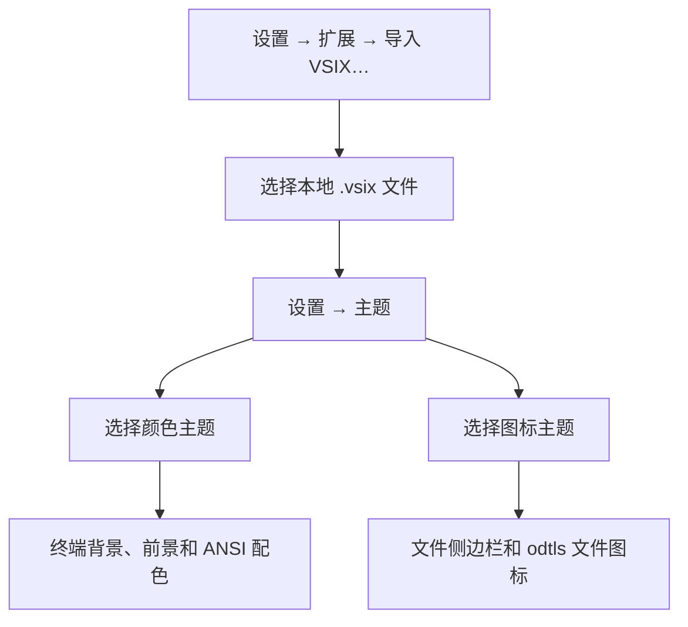
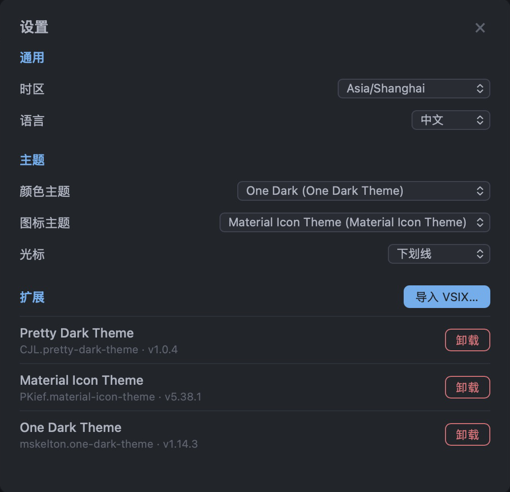
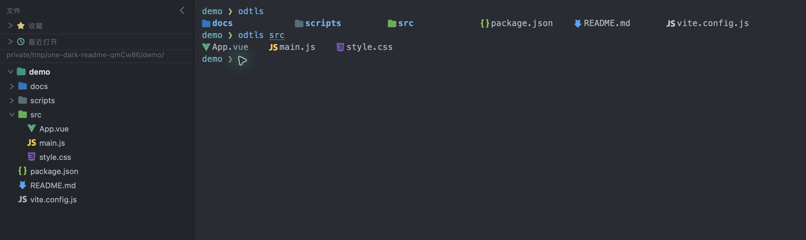
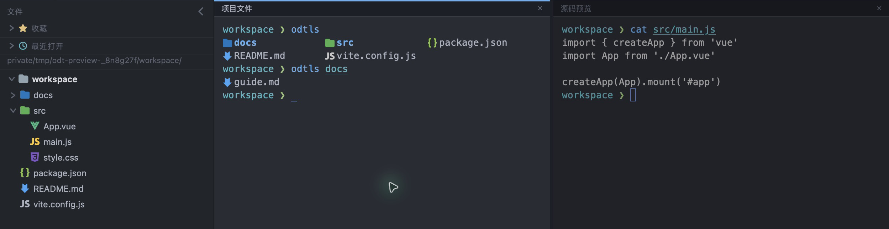

# One Dark Terminal

One Dark Terminal 是一款桌面终端，内置 One Dark 配色和 Nerd Font 图标，并支持**安装 VS Code 的 `.vsix` 颜色主题和图标主题**。可以在同一个窗口里管理分屏会话、浏览项目目录和打开文件编辑。

## 安装主题

1. 准备包含颜色主题或图标主题的 VS Code `.vsix` 文件。
2. 点击窗口右上角的齿轮，打开**设置**。也可以按 macOS 的 `⌘,` 或 Windows 的 `Ctrl+,`。
3. 在**扩展**中点击**导入 VSIX…**，选择本地文件。
4. 在**主题**中启用导入的主题。例如，**颜色主题**选 `One Dark (One Dark Theme)`，**图标主题**选 `Material Icon Theme`。



切换颜色主题后，当前窗口的终端会即时更新。在下拉菜单中可以切回内置主题，也可以在**扩展**中卸载已导入的主题包。



## 功能亮点

- **标签页与分屏** — 通过右键菜单把已有会话合并到分屏，或把分屏中的会话移到单独的标签页。把标签拖出窗口，可将整组会话移到新窗口。
- **文件侧边栏** — 可收藏目录、查看最近打开的目录，或拖入文件夹，在该目录新开终端。macOS 上侧边栏会跟随当前窗格的工作目录，Windows 上显示会话的启动目录。
- **内置编辑器** — 从文件侧边栏打开文件，编辑器为 JavaScript、Vue、Rust、Markdown 等常见文件提供语法高亮。
- **后台保留会话（macOS）** — 点击窗口左上角的红色关闭按钮会隐藏窗口，正在运行的命令和服务会继续运行。可以从 Dock 重新打开窗口。





## 安装和本地开发

- **macOS Apple Silicon** — 打开 `.dmg`，将 **One Dark Terminal** 拖到「应用程序」。`odtls` 随 macOS 版提供。
- **Windows x64** — 运行 `-setup.exe` 安装包。新终端会话默认启动 Windows PowerShell。

在 GitHub Actions 的 **Package desktop apps** 工作流中可以手动打包。安装包会出现在该次运行的 **Artifacts** 中。

从源码启动需要 Node.js 和 Rust。macOS 还需要 Xcode 命令行工具，Windows 需要 MSVC 生成工具和 WebView2。在仓库根目录运行：

```bash
npm ci
npm run tauri dev
```

构建当前平台的安装包：

```bash
npm run tauri build
```

默认输出位于 `src-tauri/target/release/bundle/`，macOS 安装包在 `dmg/`，Windows 安装包在 `nsis/`。
